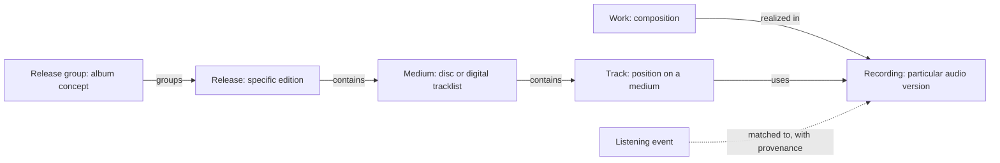

# MusicMesh: music data standards and enrichment report

**Research date:** 17 October 2026
**Scope:** MusicMesh's current entity model, MusicBrainz, Last.fm, ListenBrainz, related products, local databases, and Prisma/hosted PostgreSQL options.
**Status:** Findings and recommendations. No application, schema, or production data changes were made.

## Recommendation

Use **MusicBrainz's definitions and identifiers for musical identity**, **ListenBrainz for listening events and their mappings**, and **Last.fm for selected discovery and preference signals**. Keep MusicMesh's own concepts for scenes, equipment, techniques, and evidence where they serve questions that the external catalogs do not answer.

The highest-value change is to distinguish a composition, a recording, a track on a particular edition, and an album concept. The next is to connect those objects to your history with explicit, inspectable identity mappings. **Keep the selected catalog data, listening events, and mappings in hosted PostgreSQL accessed through Prisma.** Our existing Neon deployment is the simplest first home; Prisma Postgres is a credible alternative hosting service. A separate full MusicBrainz mirror, local or hosted, becomes valuable for broad credit, membership, place, and historical relationship queries.

This would support questions such as:

- Which musicians, producers, and studios connect artists I repeatedly listen to?
- Which versions of the same composition have I heard, and which have I missed?
- Which recordings connect my listening to a scene, label, or instrument?
- Which recommendations are supported by listening similarity, and which by documented musical connections?

These are proposed capabilities, not features currently wired into MusicMesh.

## 1. What MusicMesh actually defines today

I inspected the active code at commit `a9cb4d7`, queried the configured PostgreSQL database in a read-only transaction, profiled the original Last.fm CSV, and checked the public ListenBrainz API. The saved database inventory is [live-inventory.json](live-inventory.json).

### Three different meanings of “class”

| Layer | Current implementation | Implication |
|---|---|---|
| Physical database models | Prisma `Entity`, `Relationship`, `ImportBatch` | There are no separate `Artist`, `Album`, or `Recording` tables. |
| Accepted entity vocabulary | 58 labels in `ALLOWED_NODE_LABELS` | The writer restricts labels, but does not define required fields or semantic rules for each class. |
| Display grouping | UI catalog groups labels and relationship names | A browse category is not a database constraint or a definition of identity. |

The live graph has **312 entities, 505 relationships, 19 used labels, and 56 relationship types**. Every entity currently has `source: chat`; every entity and relationship has an empty `extra` object. No MusicBrainz identifier fields were found in those objects, and the Prisma schema has no dedicated external-identifier mapping model.

| Used label | Count | Used label | Count |
|---|---:|---|---:|
| Person | 70 | Band | 55 |
| Album | 43 | Genre | 27 |
| Song | 17 | Track | 14 |
| Place | 13 | Technique | 13 |
| RecordLabel | 10 | Scene | 8 |
| Studio | 8 | Instrument | 7 |
| Entity | 6 | Guitar | 5 |
| MusicScene | 5 | Style | 4 |
| Venue | 4 | Country | 2 |
| Release | 1 | | |

`Recording`, `Work`, and `Composition` are accepted labels but currently unused. `ReleaseGroup`, `ArtistCredit`, `ListeningEvent`, and `Area` are not in the writer's accepted label set. This is a useful moment to clarify meanings before thousands of imported identities enter the graph.

### The consequential gaps

1. **Overlapping labels lack an explicit crosswalk.** `Song` and `Track`, `Album` and `Release`, `Scene` and `MusicScene`, and `Genre` and `Style` can express different things or duplicate the same thing. Renaming them mechanically would be unsafe.
2. **Identity is local and often name-derived.** New entities can fall back to a `chat-<type>-<name-slug>` domain ID. Existing canonical matching also participates, but the schema's type/domain-ID index is not unique. Same-title releases and same-name artists need stronger external identity handling.
3. **Relationship meanings are open-ended.** The planner explicitly allows new relationship names. The writer sanitizes their syntax; it does not enforce a domain/range catalog such as “membership connects a person to a group.” Existing pairs include `INFLUENCED` and `INFLUENCED_BY`.
4. **The writer merges relationships by source, type, and target.** It can update all matching edges. Separate membership periods, performances, or credits between the same objects must not be collapsed through this path. The database can hold parallel edges; the current chat merge behavior needs different treatment for event-like data.
5. **Provenance exists but is coarse.** `source`, `evidenceBasis`, `confidenceScore`, and chat IDs are useful foundations. They do not yet distinguish a provider's assertion, a mapping algorithm's suggestion, an analyst's interpretation, and a human correction.
6. **Six generic entities remain.** These include Fender Twin Reverb, Fender Deluxe Reverb, Marshall amplifiers, Roland Jazz Chorus, Roland Corporation, and Roland GR guitar synthesizer systems. Several can use already accepted equipment/company labels after individual review.

Relevant code: [Prisma schema](../../../prisma/schema.prisma), [domain writer](../../../src/graphDomainWriter.js), [planner and grounding](../../../src/graphChatOrchestrator.js), [property storage](../../../src/graphProperties.js), and [UI filter catalog](../../../ui/src/graph-demos/graphFilterCatalog.json). The older snapshot in [Ontology Review](../../product/ONTOLOGY_REVIEW.md) should not be used for today's counts.

The Last.fm import is currently an external ListenBrainz history plus local files in `data-lastfm/`. Searches of `src`, `ui/src`, `api`, and `prisma` found no MusicBrainz/Last.fm/ListenBrainz integration references. Account setup and successful history import do not establish an application integration.

## 2. What to adopt from MusicBrainz

MusicBrainz is useful as a practical domain model, not just a list of metadata fields. Its API has 13 core entity resources: artist, recording, release, release-group, work, label, area, place, event, instrument, genre, series, and URL. Track, medium, and artist-credit structures add essential context. [API](https://musicbrainz.org/doc/MusicBrainz_API), [database schema](https://musicbrainz.org/doc/MusicBrainz_Database/Schema).

### The distinction that matters most



The listening-event connection is a proposed MusicMesh addition. The rest depicts the catalog distinctions we should adopt.

| Concept | Meaning | Recommendation for MusicMesh |
|---|---|---|
| **Work** | The composition or other intellectual creation | Use for songwriting, covers, adaptations, and composition relationships. Review each existing `Song`; some may actually describe recordings. |
| **Recording** | A particular recorded audio version | Make this the principal catalog target for a listen when a match is available. Keep distinct performances and mixes distinguishable. |
| **Track** | A recording's placement and credit on a medium | Reserve for tracklist positions. Do not use it as an interchangeable name for Recording. |
| **Medium** | A component of a release, such as a disc | Keep ordered media and tracks when edition detail is needed. This is different from a general material/technology concept. |
| **Release** | A particular published edition | Attach edition-specific date, country, barcode, label/catalog number, format, and tracklist. |
| **ReleaseGroup** | The album/single/EP concept grouping editions | Most current `Album` objects are candidates for this meaning, subject to review. Preserve the user-facing word “album.” |

The composition layer makes different artists' performances comparable. MusicBrainz works can also have parent/part and derivative relationships; the work does not simply inherit a single performing artist. [Work](https://musicbrainz.org/doc/Work).

Different mixes and edits can be distinct recordings. A remaster alone does **not** automatically justify a new recording; MusicBrainz's recording guidelines provide the boundary. This is particularly relevant to your interest in specific versions and musical passages. [Recording guidelines](https://musicbrainz.org/doc/Style/Recording).

Release groups let us answer “how often did I listen to this album?” across editions without pretending that every edition is identical. [Release group](https://musicbrainz.org/doc/Release_Group).

### People, roles, credits, places, and context

| Current MusicMesh labels | Adopt or align with | What this improves |
|---|---|---|
| Artist, Band, Person, Member | Artist identity with a person/group subtype; membership as a relationship | One person can perform, produce, and belong to several groups without becoming several disconnected people. |
| Producer, Engineer, Contributor | Roles on contributions by an artist/person | Separate who someone is from what they did on a particular recording or release. |
| Credit, Contribution | Ordered artist credits plus typed contribution relationships | Keep main billing separate from instrumental, writing, and production credits. |
| RecordLabel, Label | Label identity | Distinguish an imprint from a manufacturer or parent company. |
| Place, City, State, Country | Area for geography | Distinguish a city or country from a physical venue. |
| Venue, Studio, StudioRoom, Room | Place, with appropriate local subtypes | Connect a recording location to its geographical area without merging the building with the city. |
| Genre, Style | Recognized genre vocabulary plus separately attributed tags | Retain differing classifications rather than forcing every community tag into Genre. |
| Instrument, Guitar | Instrument vocabulary plus separate equipment/model identities | Link a guitar type, a Fender model, and a particular owned instrument without treating them as identical. |
| Missing Event and Series | Add only when a concrete query needs them | Concerts, festivals, tours, and recurring release series can become navigable objects. A recording session need not be a public concert event. |

MusicBrainz treats music professionals as artists and distinguishes person, group, orchestra, choir, character, and other artist types. Persona and alias handling deserves care: two performance identities are not always merely spelling variants. [Artist](https://musicbrainz.org/doc/Artist), [artist guidelines](https://musicbrainz.readthedocs.io/en/latest/style_guides/artist.html).

An **artist credit** preserves ordered participants, their credited names, and joining text. “Artist A feat. Artist B” should not require inventing a new group. Contribution relationships separately identify who played, wrote, engineered, or produced. [Artist credits](https://musicbrainz.org/doc/Artist_Credits).

MusicBrainz relationships carry type-specific attributes, credited names, and optional begin/end dates, including partial dates. We should adopt those concepts: “member during 1978–1982” is more useful than an undated membership, and “guitar on this recording” is more precise than a general association. [Relationships](https://musicbrainz.org/doc/Relationships).

Genre assignment is still subjective. MusicBrainz recognizes selected tags as genres and permits voting; it does not make every genre assertion an objective musical fact. [Genre](https://musicbrainz.org/doc/Genre).

### Preserve MusicMesh's additional scope

Scenes, techniques, signal chains, equipment models, manufacturers, sessions, mixes, masters, stems, and documentary evidence remain useful local concepts. MusicBrainz alignment should give them reliable connections to catalog identities. It should not force every local object into an ill-fitting external class.

For example, the proposed chain `recording → musician → instrument type` can come from catalog credits, while `session → used equipment model → manufacturer` may require interviews, session sheets, or other documented evidence. Neither a genre tag nor an audio fingerprint establishes which amplifier was used.

### Identity and relationship rules worth adopting

These are recommendations for our application contract:

- Keep existing internal entity IDs stable. Add typed external IDs keyed by provider, entity type, and identifier; do not replace saved graph-link IDs with MBIDs.
- Preserve original IDs as well as resolved/current IDs. Provider merges and redirects should not erase the source value.
- Keep display name, sort name, aliases, and disambiguation separate. Equal names do not establish equal identities.
- Preserve date precision: an unknown month/day must stay unknown rather than becoming January 1.
- Define relationship direction, allowable endpoint classes, and contextual fields. Normalize inverse spellings through an explicit crosswalk.
- Store multiple contributions or dated episodes where they actually occurred. Source/type/target alone is insufficient identity for every edge.
- Preserve the source relationship type and its identifier when available, even if the UI presents a simpler label.
- Record provenance at assertion/mapping level, with retrieval time and method. A provider similarity score and our confidence in an identity match are different quantities.

MusicBrainz's identifier and relationship documentation provide the external reference points; the storage rules above are proposed MusicMesh design choices. [MBIDs](https://musicbrainz.org/doc/MusicBrainz_Identifier), [relationship catalog](https://musicbrainz.org/relationships).

## 3. What Last.fm contributes

Last.fm exposes a useful behavioral and discovery vocabulary through its API. Its published API is not an equivalent replacement for MusicBrainz's detailed recording/release/work model. Treat its artist, album, and track objects as provider-specific views until their identity is resolved.

| API capability | Useful addition | How we should interpret it |
|---|---|---|
| `user.getRecentTracks` | Listening history with time and submitted names | Event evidence; preserve the original text and distinguish now-playing from completed plays. |
| `user.getTopTracks`, top artists/albums | Counts and rankings over a selected period | A dated aggregation, not an intrinsic property of the artist or proof of liking. |
| `user.getLovedTracks` | Explicit preference | Distinct from inferred preference based on repeated plays. |
| `artist.getSimilar`, `track.getSimilar` | Recommendation candidates | A provider's similarity signal, not evidence of historical influence. |
| Track/artist/album top tags | Community descriptions | Store tag text, target, source, weight/count as supplied, and retrieval date. |
| Correction endpoints and `autocorrect` | Alternate-name and matching candidates | Preserve the original and corrected form; do not silently overwrite identity. |
| `track.getInfo` | Duration, popularity, tags, optional user context | Keep global listeners/playcount separate from your own plays. |

References: [recent tracks](https://www.last.fm/api/show/user.getRecentTracks), [top tracks](https://www.last.fm/api/show/user.getTopTracks), [loved tracks](https://www.last.fm/api/show/user.getLovedTracks), [similar artists](https://www.last.fm/api/show/artist.getSimilar), [top tags](https://www.last.fm/api/show/track.getTopTags), [artist correction](https://www.last.fm/api/show/artist.getCorrection), [track information](https://www.last.fm/api/show/track.getInfo).

`artist.getSimilar` documents a 0–1 match value. We should retain the returned direction/rank and retrieval date rather than assume every score is symmetric or comparable across providers. A good discovery explanation could say “Last.fm lists these as similar; MusicBrainz also links them through a shared musician,” with each claim separately supported.

The `track.getInfo` documentation accepts names or an MBID, can return user playcount/loved status when a username is supplied, and even shows a blank MBID in its example. This fits what your CSV demonstrates: external IDs are helpful but incomplete. A Last.fm “track MBID” should be validated before treating it as a MusicBrainz Recording ID.

### Practical access and reuse limits

Last.fm read methods commonly require an application API key even when no user authentication is needed. Logging into Edge is not equivalent to configuring that key in MusicMesh. No authenticated Last.fm API feature was tested in this research.

The published terms specify noncommercial use unless a commercial agreement is obtained, attribution/link requirements, a **100 MB Reasonable Usage Cap**, caching according to HTTP headers, and restrictions on public pages using the service. Audio, audiovisual content, images, and artwork are excluded from the API agreement. The API landing page additionally asks commercial or research/academic users to contact Last.fm. These are provider-published constraints to resolve for the intended product use; they do not prevent adopting general concepts such as listening events and time-windowed statistics. [API terms](https://www.last.fm/api/tos), [API overview](https://www.last.fm/api).

**Recommendation:** use a bounded Last.fm enrichment cache and keep its payloads attributable and separable from MusicBrainz core data. Do not plan a wholesale Last.fm catalog mirror or assume returned artwork is licensed for reuse.

## 4. Your history: the immediate opportunity

The source CSV and fresh public ListenBrainz count both report **21,415 plays**. The CSV spans **17 August 2016 through 15 October 2026**.

| Source CSV measurement | Result |
|---|---:|
| Distinct artist-name strings | 1,014 |
| Distinct artist-name / track-title pairs | 9,264 |
| Distinct artist-name / album-title pairs | 2,428 |
| Rows with a nonblank artist MBID | 17,806 / 21,415 — 83.1% |
| Rows with a nonblank album MBID | 16,326 / 21,415 — 76.2% |
| Rows with a nonblank track MBID | 16,655 / 21,415 — 77.8% |
| Rows with a blank album name | 0 |

These are text-based distinct counts and identifier-presence measurements, not counts of verified canonical artists, recordings, or editions. The same title may hide multiple recordings; spelling variants may inflate counts.

In a fresh sample of the **100 most recent ListenBrainz plays**, all 100 had mapped recording, release, release-group, artist, and cover-art identifiers. This establishes that enrichment is already available. It does not establish complete coverage or correct version matching across all 21,415 plays.

### A concrete example from your data

Your latest play is The Decemberists' **“Severed”**, submitted with album **“I'll Be Your Girl.”** ListenBrainz returned:

- Recording MBID `bf7c0045-d389-4ef9-9df4-0a375000076c`.
- Release-group MBID `ac02498c-272e-49cd-8c1c-52fd7061c896`.
- A release MBID different from the source CSV album MBID.
- Through its metadata endpoint: duration **243,000 ms**, ISRC **USUM71713808**, first release date **2018-01-17**, artist type **Group**, external links, and tags attached at artist and release-group levels.

That is substantially richer than the original scrobble. It also illustrates two limits: the metadata response had **no recording contribution relationships**, and the mapped release is not evidence of the exact edition you played. Artist-level tags must not silently become assertions about every recording.

Live read endpoints: [latest listens](https://api.listenbrainz.org/1/user/nickknyc/listens?count=100), [count](https://api.listenbrainz.org/1/user/nickknyc/listen-count), and [Severed metadata](https://api.listenbrainz.org/1/metadata/recording/?recording_mbids=bf7c0045-d389-4ef9-9df4-0a375000076c&inc=artist%20release%20tag). Checked 17 October 2026; responses can change.

ListenBrainz explicitly distinguishes submitted `additional_info` from its read-only `mbid_mapping`. Its mapped identifiers are its best canonical match, not an assurance of exact edition identity. Our import already preserves the original Last.fm identifiers under `lastfm_*` fields rather than declaring their type. [Listen JSON and mapping](https://listenbrainz.readthedocs.io/en/latest/users/json.html).

### Proposed records for a first integration

These are conceptual records, not a requirement to create a separate table for every row:

| Record | Minimum information | Purpose |
|---|---|---|
| ListeningEvent | Stable local ID, account, UTC time, original artist/title/album, import provenance | Preserve what was actually reported. |
| IdentityMapping | Event/source-item reference, target entity, provider, method, status, observed time, original and resolved IDs | Make enrichment reversible and uncertainty visible. |
| CatalogEntity | Internal ID, precise type, typed external IDs, names and aliases | Reuse one identity across many plays. |
| Contribution | Artist, target recording/work/release, role, instrument, credited name, dates, source | Support meaningful musical connections. |
| TagAssignment / SimilarityObservation | Target(s), provider, tag or score, scope, retrieval time | Keep community/algorithmic evidence distinguishable. |
| Preference / ListeningSummary | User, target, explicit feedback or calculated metric, time window, calculation version | Avoid turning exposure into an unsupported taste claim. |

The same Last.fm play imported through ListenBrainz must not become two plays. Preserve origin and ingestion lineage, reconcile overlaps, and flag ambiguous collisions. Timestamp alone is not a reliable universal event ID; repeated plays of the same recording are legitimate events.

The smallest useful enrichment pass is: obtain a current account export; retain raw events; inspect mapping coverage; deduplicate lookup targets; retrieve relevant recording/artist/release metadata; audit uncertain matches; then derive summaries. ListenBrainz has dedicated account-export and batch metadata APIs, so downloading its global database is unnecessary for your history. [Export API](https://listenbrainz.readthedocs.io/en/latest/users/api/export.html), [metadata API](https://listenbrainz.readthedocs.io/en/latest/users/api/metadata.html).

## 5. Other products and datasets worth using

| Product or dataset | Value for MusicMesh | Priority and limit |
|---|---|---|
| **ListenBrainz metadata APIs** | Batched metadata, mappings, artist credits, links, artwork references | **First.** Already demonstrated on your history; detailed credits may still be absent. [Docs](https://listenbrainz.readthedocs.io/en/latest/users/api/metadata.html). |
| **MusicBrainz canonical datasets** | Local matching and representative recording/release groupings | **High.** CC0 CSV datasets; not a complete credit graph. Preserve original identities. [Docs](https://musicbrainz.org/doc/Canonical_MusicBrainz_data). |
| **Troi** | Playlist construction, recommendations, resolving MBID playlists to local files | **Next.** Useful reference/toolkit; Roon integration is not established by this research. [Troi](https://troi.readthedocs.io/en/latest/), [local playlist guide](https://troi.readthedocs.io/en/latest/user-guide.html). |
| **Cover Art Archive** | Release-linked art and thumbnails | **Useful presentation layer.** Images have separate rights; catalog licensing does not license album art. [Cover processing](https://picard-docs.musicbrainz.org/en/latest/appendices/coverart_processing.html), [copyright policy](https://musicbrainz.org/doc/Copyright_and_DMCA_Compliance). |
| **Picard** | Identify and tag actual local audio files with MusicBrainz metadata | **Useful if working with local media.** It does not enrich a scrobble-only CSV by acoustic analysis. [Picard](https://picard.musicbrainz.org/). |
| **AcoustID / Chromaprint** | Audio fingerprint-based identity candidates | **Conditional.** Independent ecosystem project; needs audio/fingerprints. Free service is noncommercial and rate-limited. [Web service](https://acoustid.org/webservice), [Chromaprint](https://acoustid.org/chromaprint). |
| **CritiqueBrainz** | Human reviews and ratings linked to catalog objects | **Secondary.** Useful attributed opinion, not factual credit evidence; retain each review's license. [About](https://critiquebrainz.org/about). |
| **AcousticBrainz archives** | Historical loudness, rhythm, tonal descriptors and model outputs | **Experimental only.** Collection ended; downloadable archives remain. Coverage and model quality need evaluation. [Downloads](https://acousticbrainz.org/download), [data definitions](https://acousticbrainz.org/data). |
| **ListenBrainz global dumps** | Population-level listening research and recommendation experiments | **Later.** Excessive for one account's history. Listen data/text is CC0. [Downloads](https://listenbrainz.org/download/). |
| **MLHD+** | A cleaned historical listening dataset derived from Last.fm | **Research-only candidate.** Different terms from CC0 canonical data; MetaBrainz lists noncommercial use only. [Derived datasets](https://metabrainz.org/datasets/derived-dumps). |

Troi is especially relevant to turning discovery into playable results: it can combine recommendation pipelines with a local content database and resolve global playlists to local files. Its documentation distinguishes the supported service APIs from Labs/dataset endpoints with weaker availability commitments. We should avoid making an experimental endpoint essential to the MusicMesh answer path. [Troi architecture and availability](https://troi.readthedocs.io/en/latest/).

AcousticBrainz should not become our default audio-analysis dependency. The project ended collection after identifying quality problems; its archives can still support a carefully measured experiment. For passage-level preferences, a whole-track feature vector would also be too coarse: any future segment analysis needs an audio asset, timestamps, extractor/model version, and uncertainty. [Project discontinuation](https://musicbrainz.wordpress.com/2022/02/16/acousticbrainz-making-a-hard-decision-to-end-the-project/).

## 6. Bringing MusicBrainz data local

There are several distinct options. A downloaded dataset, a running SQL database, and a full searchable MusicBrainz service are different deliverables.

| Option | What it provides | Tradeoff | Recommendation |
|---|---|---|---|
| Selected metadata cache | Objects and relationships relevant to your history and questions | Incomplete global coverage; needs refresh and cache misses | **Start here.** Establish the model and actual query needs. |
| Canonical CSV dataset | Local name/ID matching and representative groupings | Omits the complete relational detail | Pilot if matching becomes a bottleneck. |
| MusicBrainz JSON dumps | Entity documents convenient for batch processing | Large files; own indexing/import/update strategy | Useful for an extraction job, not automatically simpler for graph joins. |
| PostgreSQL mirror without indexed search | Broad catalog and relationship SQL queries | Imports, replication, schema upgrades, operational storage | **Preferred full-local option** when broad graph exploration becomes the goal. |
| Full mirror with website/API/indexed search | Local service similar to MusicBrainz | More services and significantly more resources | Add only if local search/API compatibility is needed. |

### Canonical datasets: attractive, with an important meaning

The canonical release mapping chooses a representative release for a release group. The canonical recording mapping can consolidate variations, including live versions, for recommendation-oriented equivalence. These choices can change between dataset versions. This is different from an identity-preserving redirect after a duplicate entity merge.

Therefore retain both **exact/source recording identity** and **canonical grouping identity**, plus dataset date. A canonical group is useful for broad taste summaries; it must not overwrite the version a listener actually heard. The canonical metadata CSV can support local matching without importing the whole catalog. The documented schedule is the 1st and 15th of each month. Exact compressed size was not verified because the download flow led to account signup. [Canonical data](https://musicbrainz.org/doc/Canonical_MusicBrainz_data).

### Full mirror: operational reality

MusicBrainz publishes PostgreSQL-loadable dumps. Core catalog, supplementary data, edit history, and artwork-link metadata are separate files. The artwork dump contains references, not image files. Download only the categories needed for the intended queries, and verify checksums/signatures. Genre assignments require supplementary tag data. [Dump contents](https://musicbrainz.org/doc/MusicBrainz_Database/Download).

The official `musicbrainz-docker` project documents approximately:

| Mode | CPU threads | RAM | Disk |
|---|---:|---:|---:|
| Without indexed search | 2 | 4 GB | 100 GB |
| With indexed search | 16 | 16 GB | 350 GB |

These are upstream planning figures, not measured requirements for today's database. Allow extra space for compressed downloads, temporary import/index work, backups, and growth. Search indexing is maintained separately from SQL replication. The project documents Linux/macOS and explicitly says Windows setup is not documented. A Linux environment is the appropriate evaluation target. [Official mirror project](https://github.com/metabrainz/musicbrainz-docker).

This computer reports **63.9 GiB installed RAM, 16 logical processors, and 2,935.8 GiB free on D:**. Docker and WSL executables are present. Capacity appears sufficient for an evaluation, but I did not validate daemon health, Linux setup, container allocations, import performance, or actual database disk use. A local mirror has not been installed.

For MusicMesh, keep a mirror in a **separate database/service** from the production Neon application database. Keep its configuration and explicitly located data under the MusicMesh project root, with bulk data excluded from Git. Preserve upstream schema compatibility; derive a small application-facing selection rather than reshaping the mirror itself. A running Windows workstation would also need an explicit availability/access arrangement before the Azure-hosted app could depend on it.

The official Docker repository includes a database-only mirror configuration. MusicBrainz also links to `mbslave`, which provides database initialization and synchronization without the entire website stack. `mbslave` warns that schema changes can interrupt replication and need upgrades. Choose one maintained mirror path; do not build a custom dump parser unless a specific extraction task requires it. [MusicBrainz download guidance](https://musicbrainz.org/doc/MusicBrainz_Database/Download), [mbslave](https://github.com/acoustid/mbslave).

Replication is a continuing operation, not a one-time import: obtain the appropriate MetaBrainz token, monitor applied sequence/lag, and handle schema upgrades and failed updates. Personal/noncommercial users can obtain a free feed token; hourly packets enable close synchronization when applied promptly. [Live Data Feed](https://musicbrainz.org/doc/Live_Data_Feed).

### Licensing affects which data we combine

| Data | Published terms relevant to the choice |
|---|---|
| MusicBrainz core database | CC0 |
| MusicBrainz supplementary data | CC BY-NC-SA 3.0; includes data such as tags, ratings, annotations |
| MusicBrainz replication packets | CC BY-NC-SA 3.0; commercial arrangements should be resolved with MetaBrainz |
| Canonical MusicBrainz datasets | CC0; commercial financial support requested |
| ListenBrainz user listen data/text | CC0 |
| Last.fm API data | Provider API agreement; not a general open-data mirror license |
| Artwork and reviews | Asset/review-specific rights; do not inherit the catalog's CC0 status |

Sources: [MusicBrainz licenses](https://musicbrainz.org/doc/About/Data_License), [canonical datasets](https://metabrainz.org/datasets/derived-dumps), [ListenBrainz downloads](https://listenbrainz.org/download/), [Last.fm terms](https://www.last.fm/api/tos).

The practical design consequence is source-aware storage and export. Do not label a combined payload “CC0” merely because its core identities came from MusicBrainz. A personal prototype and a public/commercial MusicMesh service may need different permissions.

## 7. Keeping the data on Prisma or hosted PostgreSQL

This section interprets your follow-up “Prism” as **Prisma** and covers both possible meanings.

### Prisma is already in our stack; the database host is Neon

The live connection resolves to Neon and database `musicmesh`. Its current logical database size is **8,519,680 bytes, approximately 8.1 MiB**, before loading any listening history into it. Prisma 7.10.0 and `@prisma/adapter-pg` are the application's access layer; Prisma Studio is an inspection tool. **Prisma Postgres** is a separate managed hosting product. Using Prisma ORM does not require moving to Prisma Postgres.

Your request is therefore quite practical: the selected music catalog, source mappings, and listening events can live in our existing application database, queried through Prisma. That is the recommended starting point. A separate canonical-data index or full upstream mirror is a different size and operational decision.

| Data we want to keep | Recommended home | Reason |
|---|---|---|
| Your 21,415 plays, accounts, import lineage, mappings | Application PostgreSQL, with explicit Prisma models | Straightforward filtering, aggregation, deduplication, and joins to the graph. |
| Selected artists, recordings, works, releases, credits | Application PostgreSQL, retaining source IDs | Fast product answers without calling a remote catalog for every request. |
| Original provider responses | Bounded source-aware cache; archive large raw files separately | Preserve auditability without repeatedly embedding full responses in every event. |
| Full MusicBrainz catalog | Separate reference database if needed | Different schema ownership, update schedule, scale, and licensing subsets. |
| Album images or audio | File/object storage, with references in PostgreSQL | Keep binary assets out of the catalog tables and preserve their distinct rights. |

The current generic entity graph can remain useful. Add narrowly defined event and mapping records where necessary rather than making 21,415 play events flow through the chat writer's relationship-merging rules. Bulk ingestion should use batched database operations, not a model call or individual ORM request per field.

### Existing Neon versus Prisma Postgres versus a local mirror

| Choice | What it avoids or enables | Main cost/constraint | Assessment |
|---|---|---|---|
| **Existing Neon + Prisma ORM** | Reuses current production connection, deployment, and query code | Actual account quotas and workload cost must be checked before expansion | **Best first choice for the selected dataset.** No host migration needed to adopt the ontology. |
| **Separate Prisma Postgres database** | Managed Postgres, direct SQL access, ORM compatibility, hosted availability | New provisioning, import validation, billing and connection configuration | **Credible alternative.** Compare with a representative dataset and queries before moving production. |
| **Separate managed full MusicBrainz mirror** | Broad SQL joins accessible to hosted services | Large storage footprint, replication worker, extension/privilege compatibility | Possible, but not established just because the service supports PostgreSQL. |
| **Local full MusicBrainz mirror** | Uses available local disk/RAM; useful for exploration and extraction | Machine availability, maintenance, connectivity to Azure, backups | Strong research option; publish selected results to the hosted application database. |

My preferred progression is **hosted application data first, optional separate reference mirror later**. It works whether we retain Neon or eventually select Prisma Postgres. It also means the public application can answer from its hosted dataset when your workstation is off.

### Current public pricing and illustrative cost

Checked 17 October 2026; these are published rates, not a quote or verification of your account's entitlements.

| Prisma Postgres plan | Monthly base | Included storage | Included monthly operations |
|---|---:|---:|---:|
| Free | $0 | 2 GB | 200,000 |
| Starter | $10 | 10 GB | 1 million |
| Pro | $49 | 50 GB | 10 million |
| Business | $129 | 100 GB | 50 million |

Storage overage is $2/GB on Starter, $1.50/GB on Pro, and $1/GB on Business. Operation overage is respectively $8, $2, and $1 per million. Database transfer is included. At **100 GB**, Pro's base plus storage is **$124/month**; Business is **$129/month**, before operation overages. At **250 GB**, Business is **$279/month** before overages. These are illustrative database sizes, not measured MusicBrainz requirements; the local mirror's disk guidance also includes things beyond database storage. [Prisma pricing](https://www.prisma.io/pricing).

Neon currently advertises Launch at **$0.35/GB-month** plus **$0.106/CU-hour**. A hypothetical 100 GB database therefore starts with **$35/month storage**. At a continuously active 0.25 CU for 730 hours, add about **$19.35**, totaling **$54.35 before other applicable charges**. This is arithmetic under an assumed load, not a claim that 0.25 CU is sufficient for a MusicBrainz import or workload. Heavy joins, indexing, replication, history retention, and transfer can change the result. Compare actual measured use. [Neon pricing](https://neon.com/pricing).

For the selected personal dataset, the important first measurement is its imported size **including indexes and retained payloads**, rather than extrapolating from the size of the global MusicBrainz database. The current 8.1 MiB app database is only a baseline. No paid plan or database was created.

### Compatibility checks before a full hosted mirror

Prisma Postgres supports direct PostgreSQL connections and documented dump/restore imports. Use pooled connections for normal application traffic and direct connections for import/migration work. Its managed pool uses transaction pooling; session-dependent replication/import processes should not assume persistent session state through that pool. [Import guide](https://www.prisma.io/docs/postgres/import-from-existing-database), [connection pooling](https://www.prisma.io/docs/postgres/database/connection-pooling).

The current upstream MusicBrainz SQL requires `cube`, `earthdistance`, and `unaccent`, and defines an ICU collation. Prisma's published extension list includes all three extensions. MusicBrainz also provides an SQL fallback where creation of its C-language unaccent wrapper is restricted. These are encouraging signs, not proof of a successful restore and replication cycle. [Upstream extension SQL](https://raw.githubusercontent.com/metabrainz/musicbrainz-server/master/admin/sql/Extensions.sql), [upstream collation SQL](https://raw.githubusercontent.com/metabrainz/musicbrainz-server/master/admin/sql/CreateCollations.sql), [Prisma extensions](https://www.prisma.io/docs/postgres/database/postgres-extensions).

A pilot must still prove ICU support/permissions, upstream schema creation, bulk load, indexes and constraints, a replication cycle, representative joins, and backup restoration. A database host does not itself run the MusicBrainz replication scheduler or search server; those need a worker/runtime. Do not use Prisma Migrate to take ownership of and rewrite the upstream MusicBrainz schema. Keep the application schema under our migrations and the mirror under its upstream upgrade process.

For complex catalog traversal, Prisma can remain the application boundary while parameterized SQL performs the appropriate joins. There is no need to turn the entire MusicBrainz schema into hundreds of new application classes before testing useful queries. The existing [graph store](../../../src/graphStore.js) already uses a recursive SQL query and bounds the returned graph slice. That is a useful foundation, although high-degree nodes and large catalog joins still need benchmarks; a return limit alone does not establish a low execution cost.

**Decision:** retaining selected enriched music data in hosted PostgreSQL through Prisma is recommended. Migrating hosts or keeping the entire MusicBrainz database there is a separate decision that needs a measured pilot.

## 8. Recommended sequence and acceptance criteria

### First: agree the vocabulary and protect identity

Define the core classes and an explicit crosswalk for all existing labels. Add typed external identity, date precision, and contextual contribution rules to the application contract. Review the 43 Albums, 17 Songs, 14 Tracks, one Release, and six generic entities individually where the intended meaning is unclear.

**Success:** current graph IDs and links survive; ambiguous objects stay unresolved; Work/Recording/Track and ReleaseGroup/Release are distinguishable; dated parallel relationships survive persistence.

### Second: connect the history and enrich a representative sample

Start with the account export and a sample spanning recent/old plays, top artists, rare artists, collaborations, live/remixed titles, and missing source IDs. Measure coverage at both play and distinct-item levels. Compare source IDs with ListenBrainz mappings; retrieve credits and catalog context for matched recordings. Use Last.fm similarity/tags only for selected questions and within its applicable terms.

**Success:** all 21,415 source events remain attributable; overlapping imports do not double counts; uncertain matches are reversible; exact editions are not invented; contributions show source evidence. Demonstrate a real cross-artist connection through MusicMesh's chat and graph before expanding the import.

### Third: select the local data footprint from measured need

If the sample answers useful questions with cached metadata in hosted PostgreSQL, continue that route. Compare existing Neon with Prisma Postgres using measured storage and representative queries. If missing relationships, broad joins, or repeated API limits prevent the intended exploration, evaluate a separate database-only mirror, either local or on a compatible managed host with a replication worker. Compare coverage, answer latency, import cost, maintenance effort, and the size of the actual materialized dataset.

**Success:** the chosen approach answers the intended questions and has a repeatable refresh path. Having downloaded a dump alone is not completion.

### Fourth: add discovery and playable outcomes

Combine documented connection paths with separately labeled similarity and preference signals. Evaluate Troi for playlist generation/local-file resolution. Consider audio-feature or passage analysis only when the question requires it and the audio is available.

**Success:** recommendations have understandable reasons; playback targets resolve; listening count, explicit liking, catalog fact, and inferred musical similarity remain distinct.

## 9. Evidence, reproduction, and remaining unknowns

All observations are dated 17 October 2026. The database inventory used the project's existing Prisma connection with `SET TRANSACTION READ ONLY`, followed by `entity.findMany()` and `relationship.findMany()`. No mutation, model call, schema migration, or deployment was run.

Read-only orientation commands, from `D:\Studio13\Lab\Code\MusicMesh`:

```powershell
git status --short
git log --oneline -n 5
Get-Content -LiteralPath prisma/schema.prisma -Raw
Get-Content -LiteralPath src/graphDomainWriter.js -Raw
Get-Content -LiteralPath src/graphChatOrchestrator.js -Raw
npm run ontology:review
python data-lastfm/import_listenbrainz.py --verify
```

The last two commands are existing reproduction tools; the research used a direct read-only inventory and fresh public API reads instead. CSV metrics use exact case-sensitive strings from [the original CSV](../../../data-lastfm/recenttracks-bobdobbsnyc-1792084706.csv), without altering it. Import evidence remains in [the receipt](../../../data-lastfm/listenbrainz-import-receipt.json).

**Limits of this report:** full-history mapping accuracy was not audited; Last.fm API responses were documented rather than authenticated/tested; no local mirror import or resource benchmark was performed. Several MusicBrainz documentation requests were rate-limited; official indexed documentation supplied the relevant definitions. A direct recording lookup returned HTTP 503, while ListenBrainz's corresponding metadata endpoint succeeded. Absence of a relationship in that cached response does not establish that the relationship is absent everywhere in MusicBrainz.

ListenBrainz's global-dump documentation contains inconsistent statements about incremental frequency; its download page says daily. Any future global-dump workflow should follow the actual published sequence and reconcile deletions using full snapshots. [Dump documentation](https://listenbrainz.readthedocs.io/en/latest/users/listenbrainz-dumps.html).

### Complete current accepted-label inventory

This is the code vocabulary, **not** the proposed final ontology:

```text
Artist, Band, Album, Release, Track, Song, Person, Member,
Contributor, Credit, Contribution, Producer, Engineer,
RecordLabel, Label, Scene, MusicScene, Venue, Genre, Style,
Place, City, State, Country, Recording, RecordingSession,
Session, StudioEvent, Work, Composition, Project, ArtistProject,
Mix, Master, Stem, Studio, StudioRoom, Room, Instrument,
Equipment, Amplifier, Effect, EffectsPedal, Guitar, Synthesizer,
Console, SignalChain, Manufacturer, Company, Technique, Process,
Format, Medium, Technology, Source, Evidence, Reference, Entity
```

The best next decision is to accept the core identity distinctions and evaluate them against a representative portion of your actual history. That will tell us which catalog depth improves MusicMesh and whether a full local mirror earns its operational cost.
